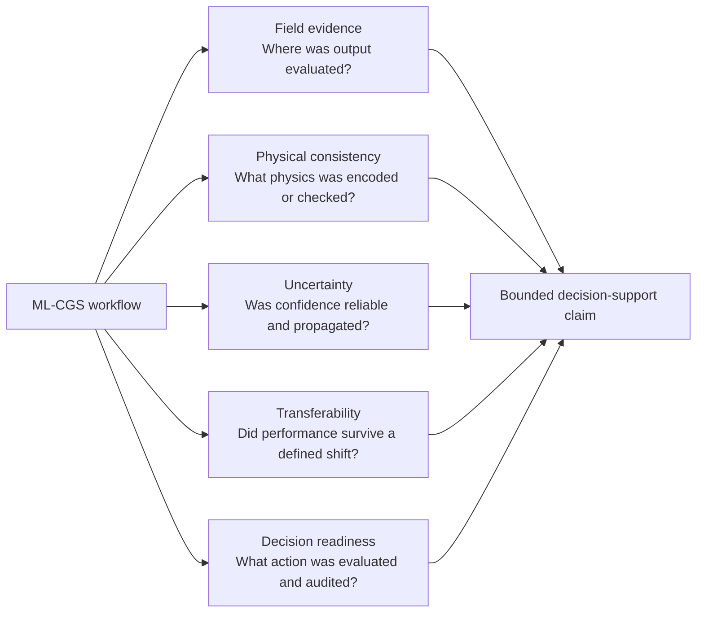
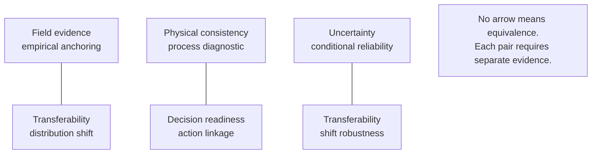

# WP9.3 Evidence-Dimension Relationship

## Non-compensatory relationship

The arrows represent independent evidence contributions. They do not define a
weighted score. A bounded decision-support claim must state which layers are
present, missing, unclear, or not applicable.

## Boundary pairs

## Interpretation rules

1. Field evidence and transferability are orthogonal. A single field case is
   not a cross-site test. A simulated blind geology test can be OOD evidence
   without being field evidence.
2. Physical encoding and physical diagnosis are different levels. A
   physics-informed loss is not a reported mass, pressure, plume, geomechanical,
   geochemical, rock-physics, or detectability diagnostic.
3. A posterior or ensemble is not calibrated merely because it is
   probabilistic. Calibration requires a reliability check.
4. A storage-relevant prediction is not an evaluated decision. Decision score
   3 requires an explicit threshold, update, alarm, or optimization mechanism.
5. Unknown, unclear, and not reported are retained as missing evidence, not
   scored as zero.

This document is a framework artifact. It does not change the locked corpus,
figures, tables, or manuscript claims.
